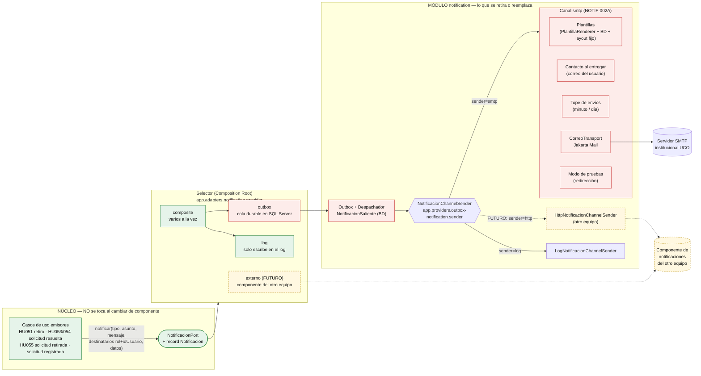
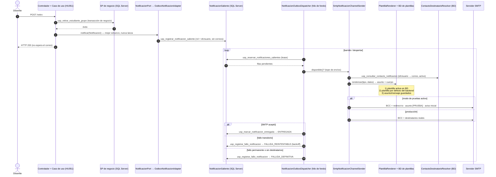
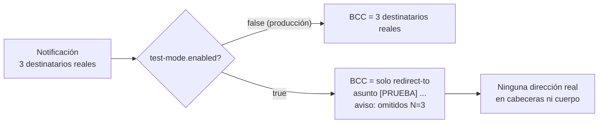
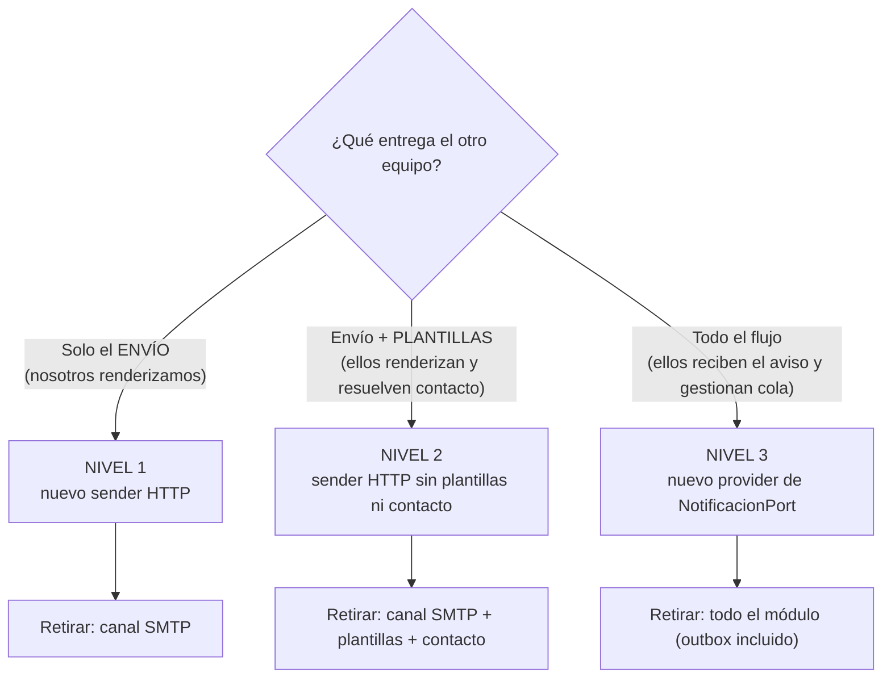

# Integración del componente de correo (NOTIF-001 + NOTIF-002A) y plan de retiro

Esta guía explica **cómo está integrado** el envío de correo, **cómo se usa** y **qué hay que retirar** cuando se reemplace por el componente de notificaciones/correo de otro equipo.

- Decisión de arquitectura: [ADR-005](../adr/ADR-005-notification-provider-switch.md) y [ADR-006](../adr/ADR-006-notification-email-and-templates.md).
- Contratos: [NOTIF-001 CONTRACT](../work-items/NOTIF-001-proveedor-notificaciones/CONTRACT.md) y [NOTIF-002A CONTRACT](../work-items/NOTIF-002A-plantillas-correo/CONTRACT.md).
- Evidencia de validación: [NOTIF-002A VALIDATION](../work-items/NOTIF-002A-plantillas-correo/VALIDATION.md).

> **Regla de oro:** el resto del sistema solo conoce `NotificacionPort`. Todo lo demás de este documento vive dentro del módulo `notification` y es **reemplazable por configuración o retirable**.

---

## 1. Vista general: qué es propio del módulo y qué no

**Leyenda:** verde = se queda siempre · rojo = se retira según el nivel de reemplazo (§5) · amarillo punteado = lo que aportará el otro equipo.

---

## 2. Flujo de una notificación (de punta a punta)

Garantías: **mejor esfuerzo** (el retiro nunca falla por el correo), **entrega al menos una vez** desde el registro, reintentos exponenciales (5 intentos) y *dead-letter* visible en la tabla.

---

## 3. Cómo se usa

### 3.1 Elegir el modo con variables de entorno

| Quiero… | Variables |
|---|---|
| Comportamiento actual, sin enviar nada (default) | *(ninguna)* → `provider=log` |
| Cola durable, correo solo al log | `APP_ADAPTERS_NOTIFICATION_PROVIDER=outbox` + `OUTBOX_NOTIFICATION_SENDER=log` |
| **Enviar correo por SMTP** | `APP_ADAPTERS_NOTIFICATION_PROVIDER=outbox` + `OUTBOX_NOTIFICATION_SENDER=smtp` + `SMTP_NOTIFICATION_HOST/PORT/USERNAME/PASSWORD/FROM_ADDRESS` (+ `STARTTLS`/`SSL`) |
| **Probar sin riesgo** (nadie real recibe nada) | lo anterior + `SMTP_NOTIFICATION_TEST_MODE_ENABLED=true` + `SMTP_NOTIFICATION_TEST_MODE_REDIRECT_TO=<tu correo>` |
| Tope de envíos | `SMTP_NOTIFICATION_RATE_PER_MINUTE` (60) y `SMTP_NOTIFICATION_RATE_PER_DAY` (500) |

Las credenciales van **solo** en variables de entorno (o el `.env` local ignorado por git), nunca en el repositorio ni en los logs. `SMTP_NOTIFICATION_TEST_MODE_ENABLED` debe estar en `false` en producción.

### 3.2 Probar un envío real

1. Completar el bloque SMTP del `.env` del backend y activar el modo de pruebas con tu correo.
2. Arrancar el backend (p. ej. `:8090`, `legacy`) y ejecutar una acción que notifique (HU051, retiro de un estudiante).
3. Verificar: el log registra `Notificacion enviada por SMTP … outcome=sent`, la fila de `NotificacionSaliente` pasa a `ENTREGADA` y el correo llega con asunto `[PRUEBA]` y el aviso inicial.
4. Restaurar los datos de prueba (matrícula del estudiante y filas del outbox).

### 3.3 Agregar un nuevo tipo de notificación

1. El caso de uso emite `Notificacion` con un `tipo` nuevo y las claves legibles necesarias en `datos` (p. ej. `grupo`, `estudiante`).
2. Declarar sus marcadores en `PlantillaNotificacionMarcador` y su plantilla v1 en `PlantillaNotificacion` (seed idempotente `26_plantillas_notificacion.sql`).
3. Opcional: recurso por defecto `notification/templates/<TIPO>.es.properties`.
4. Sin plantilla, el correo sale igualmente con el `asunto`/`mensaje` que armó el caso de uso.

### 3.4 Lo que hace el modo de pruebas

---

## 4. Inventario de lo que pertenece al módulo

### Backend (`GestioAsistenciaBackend`)

| Bloque | Ubicación | Origen |
|---|---|---|
| Outbox y despachador | `infrastructure/adapter/secondary/notification/outbox/**` | NOTIF-001 |
| Proveedores `log`, `outbox`, `composite` (Composition Roots) | `infrastructure/config/adapters/notification/{log,outbox,composite}/**` | NOTIF-001 |
| Propiedades del selector y del outbox | `NotificationAdapterProperties`, `OutboxNotificationProperties` | NOTIF-001 |
| **Plantillas** | `infrastructure/adapter/secondary/notification/template/**` (`PlantillaRenderer`, `PlantillaNotificacionJpaRepository`, `PlantillaPorDefectoCatalogo`, …) | NOTIF-002A |
| Recursos de plantillas | `src/main/resources/notification/email/layout.html`, `notification/templates/*.es.properties` | NOTIF-002A |
| **Contacto** | `infrastructure/adapter/secondary/notification/contact/**` | NOTIF-002A |
| **Canal SMTP** | `infrastructure/adapter/secondary/notification/channel/smtp/**` (`SmtpNotificacionChannelSender`, `JakartaMailCorreoTransport`, `TopeEnvios`, `CorreoSaliente`, `CorreoTransport`) | NOTIF-002A |
| Composition Root SMTP | `infrastructure/config/adapters/notification/smtp/SmtpNotificacionAdapterConfiguration` | NOTIF-002A |
| Propiedades SMTP | `SmtpNotificationProperties` (`app.providers.smtp-notification.*`, incluye `test-mode`) | NOTIF-002A |
| Dependencias | `spring-boot-starter-mail` (main) y `greenmail` (test) en el `pom.xml` | NOTIF-002A |
| Configuración | bloques `app.adapters.notification` y `app.providers.{outbox,smtp}-notification` en `application.yml`; variables `SMTP_*` y `OUTBOX_*` en `.env.template` | ambos |
| Pruebas del módulo | `*Notificacion*Test`, `NotificationWiringTest`, `SmtpNotificationWiringTest`, `NotificationEmailModuleIsolationRulesTest` (AR-07..AR-10), `NotificacionOutboxIT`, `NotificacionSmtpGreenMailIT`, `Plantilla*Test`, `ContactoDestinatario*Test`, `TopeEnviosTest`, `SmtpNotification*Test` | ambos |

### Base de datos (`GestioAsistenciaDB`)

| Bloque | Objetos | Origen |
|---|---|---|
| Cola de salida | tablas `NotificacionSaliente`, `EstadoNotificacion`; SPs `usp_registrar_notificacion_saliente`, `usp_reservar_notificaciones_salientes`, `usp_marcar_notificacion_entregada`, `usp_registrar_fallo_notificacion`, `usp_depurar_notificaciones_salientes` (+ internos); permisos `rol_asistencias_runtime_notif001.sql`; migración `07_notif001_*` | NOTIF-001 |
| Plantillas | tablas `PlantillaNotificacion`, `PlantillaNotificacionMarcador`; semilla `26_plantillas_notificacion.sql`; SP `usp_consultar_plantilla_notificacion_activa` (+ interno) | NOTIF-002A |
| Contacto | SP `usp_consultar_contacto_notificacion` (+ interno) | NOTIF-002A |
| Permisos y migración | `rol_asistencias_runtime_notif002a.sql`; migración `08_notif002a_plantillas_notificacion_up/down.sql` | NOTIF-002A |
| Pruebas | `test_notif002a_plantillas_contacto.sql` y las 6 pruebas T-SQL de NOTIF-001, registradas en `test_suite.sql` | ambos |

**Aislamiento verificable:** ninguna tabla del módulo tiene claves foráneas hacia el resto del modelo y nada del modelo las referencia; reglas ArchUnit AR-07..AR-10 impiden que otras clases dependan de los paquetes concretos.

---

## 5. Qué retirar cuando llegue el componente del otro equipo

Hay tres niveles, de menor a mayor. **Elegir según qué haga el otro componente.**

### Nivel 1 — Solo el envío lo hace el otro componente

**Se agrega:** `HttpNotificacionChannelSender` (implementa `NotificacionChannelSender`) y su Composition Root; se activa con `OUTBOX_NOTIFICATION_SENDER=http`. El outbox, el despachador, las plantillas y el contacto se **reutilizan**.

**Se retira (cuando se confirme que ya no se usa SMTP):**
- `notification/channel/smtp/**` y `SmtpNotificacionAdapterConfiguration`.
- `SmtpNotificationProperties` y sus pruebas; `SmtpNotificationWiringTest`, `NotificacionSmtpGreenMailIT`, `SmtpNotificacionChannelSenderTest`, `TopeEnviosTest`.
- Dependencias `spring-boot-starter-mail` y `greenmail`; bloque `app.providers.smtp-notification` de `application.yml`; variables `SMTP_*` de `.env.template`.
- El modo de pruebas con redirección desaparece con el canal (si el nuevo componente necesita uno, se implementa allí).

### Nivel 2 — El otro componente también renderiza y resuelve contactos

**Se agrega:** un sender HTTP que envía `tipo`, `datos` y destinatarios (`rol` + `idUsuario`) y deja que el otro lado haga el resto.

**Se retira además del Nivel 1:**
- Paquetes `notification/template/**` y `notification/contact/**`, recursos `notification/email/layout.html` y `notification/templates/*`, y sus pruebas.
- BD: tablas `PlantillaNotificacion` y `PlantillaNotificacionMarcador`, SPs `usp_consultar_plantilla_notificacion_activa` y `usp_consultar_contacto_notificacion` (con sus internos), semilla `26_plantillas_notificacion.sql`, permisos `rol_asistencias_runtime_notif002a.sql` y la prueba `test_notif002a_plantillas_contacto.sql` (migración de limpieza `down` ya incluida: `08_notif002a_plantillas_notificacion_down.sql`).
- **Antes de borrar las plantillas:** exportar las activas (seguimiento TD) para que el otro equipo parta del mismo texto.

### Nivel 3 — El otro componente reemplaza todo el proveedor

**Se agrega:** un valor nuevo de `app.adapters.notification.provider` (p. ej. `externo`) con un adaptador que implementa `NotificacionPort` llamando a la API del otro equipo.

**Se retira además del Nivel 2:**
- Paquete `notification/outbox/**`, Composition Roots `log`/`outbox`/`composite` que ya no se usen y `OutboxNotificationProperties`.
- BD: tablas `NotificacionSaliente` y `EstadoNotificacion`, los 5 SPs del outbox (con internos), permisos `rol_asistencias_runtime_notif001.sql` y la migración `07_notif001_*` (mediante una **migración de limpieza nueva**), y las 6 pruebas T-SQL de NOTIF-001.
- Documentación: marcar ADR-005 y ADR-006 como *superseded* y actualizar `adapter-composition-standard.md`.

### Lo que **nunca** se retira (en ningún nivel)

| Elemento | Motivo |
|---|---|
| `NotificacionPort` y el record `Notificacion` | Es el contrato que ven los casos de uso |
| Los 4 casos de uso emisores y sus pruebas | No conocen el canal; las claves legibles agregadas a `datos` son inofensivas y útiles al nuevo componente |
| Selector `app.adapters.notification.provider` | Es el mecanismo de cambio (igual que seguridad) |
| `LogNotificacionAdapter` | Proveedor por defecto y respaldo seguro |

---

## 6. Lista de comprobación del cambio de componente

- [ ] Definir el nivel (1, 2 o 3) con el otro equipo y acordar su contrato (HTTP/OpenAPI) **antes** de codificar.
- [ ] Escribir las pruebas RED del nuevo sender/provider reutilizando las pruebas de contrato del puerto (`NotificacionPortContractTest`).
- [ ] Implementar el adaptador nuevo detrás de `@ConditionalOnProperty` en su propio Composition Root (sin `@Component`).
- [ ] Activarlo en un entorno de pruebas con el modo de pruebas del sender apagado y el nuevo componente apuntando a un buzón de prueba.
- [ ] Ejecutar el E2E (HU051 como disparador) y comprobar entrega, reintentos y métricas.
- [ ] Retirar el código y las tablas del nivel elegido (§5) en **commits separados por capa** (BD, backend, documentación), con migración de limpieza.
- [ ] Ajustar las reglas ArchUnit AR-07..AR-10 a los paquetes que sigan existiendo; correr `mvnw test`, `-Pintegration` y el gate de BD.
- [ ] Actualizar `application.yml`, `.env.template`, `adapter-composition-standard.md`, ADR (*superseded*) y `TECHNICAL_DEBT.md`.
- [ ] Revocar las credenciales SMTP de pruebas y retirarlas del `.env`.

---

## 7. Datos de contexto

- **Privacidad:** el outbox guarda `rol` + `idUsuario`, nunca correos; el correo se consulta al entregar. Los logs no incluyen correos, asunto ni cuerpo.
- **Pendientes de terceros:** servidor SMTP institucional (host, puerto, TLS, remitente) y SPF/DKIM/DMARC del dominio remitente, que entrega TI.
- **Fuera de alcance de NOTIF-002A:** NOTIF-002B (pantalla del Administrador para editar plantillas), otros canales (SMS, push), preferencias por usuario.
